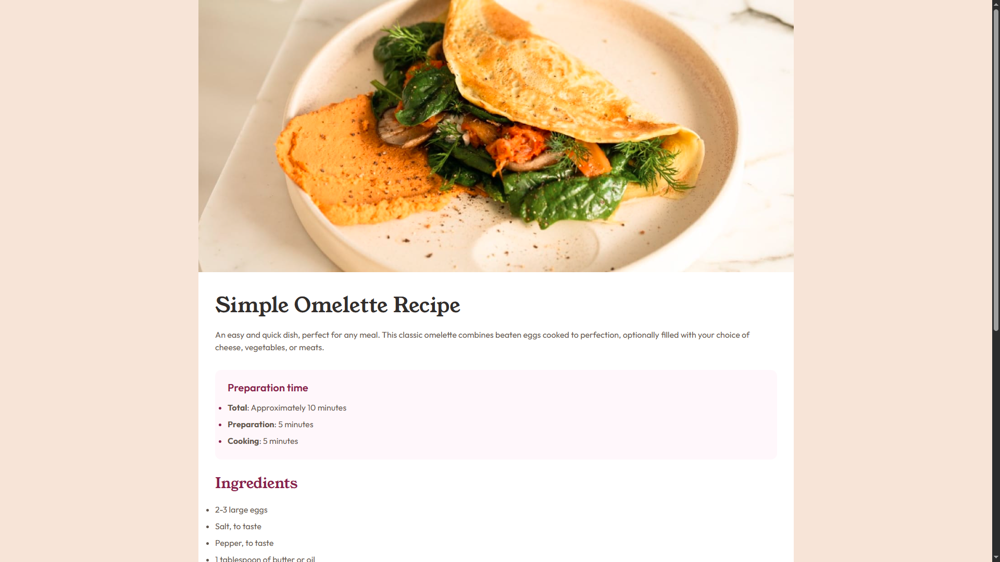
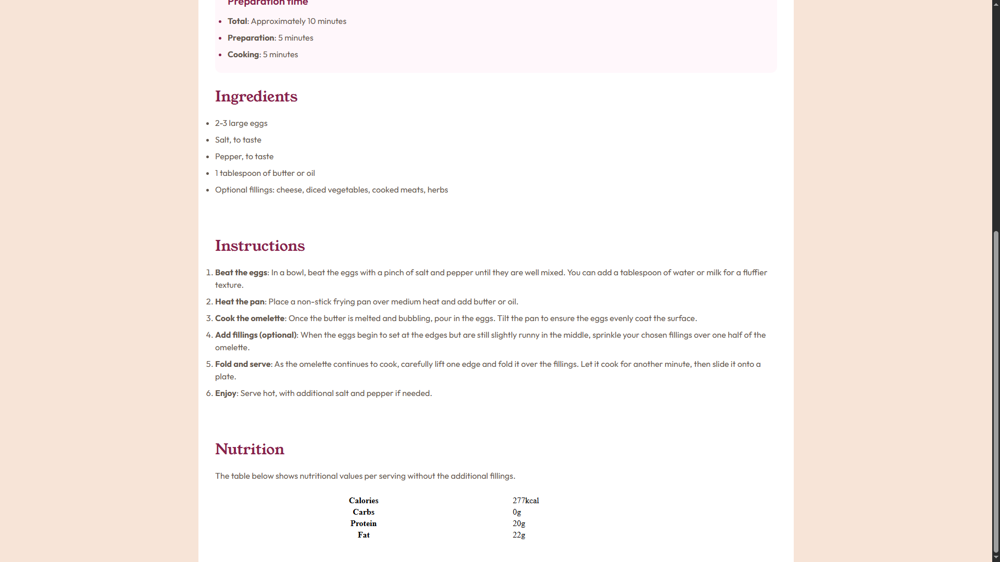

# Frontend Mentor - Recipe page solution

This is a solution to the [Recipe page challenge on Frontend Mentor](https://www.frontendmentor.io/challenges/recipe-page-KiTsR8QQKm). Frontend Mentor challenges help you improve your coding skills by building realistic projects. 

## Table of contents
 
  - [The challenge](#the-challenge)
  - [Screenshot](#screenshot)
  - [Links](#links) 
  - [Built with](#built-with)
  - [What I learned](#what-i-learned)    
  
### Screenshot

 

### Links

- Solution URL: [https://github.com/promahmoud219/Recipe-Page]
- Live Site URL: [https://promahmoud219.github.io/Recipe-Page/]
 
### Built with

- Semantic HTML5 markup
- CSS custom properties
- Flexbox 
- Mobile-first workflow
  
### What I learned

* **Avoiding Style Conflicts:** Used CSS `:not()` to exclude specific elements (like `#preparation h2`) from global styles, preventing unintended overrides regardless of code order.
* **List Spacing Limitations:** Used `display: flex` with `gap` to space out list bullets, as the `::marker` pseudo-element strictly ignores `padding` and `margin`.
* **Semantic vs. Visual Bold:** Used `<b>` purely for visual emphasis (e.g., list prefixes), reserving `<strong>` for content with genuine semantic importance and screen reader accessibility.